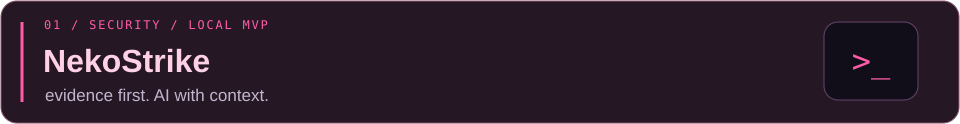
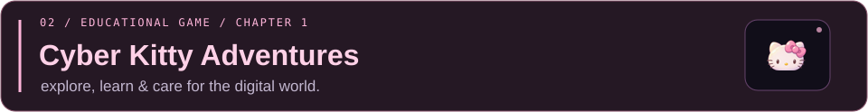

<p align="right"><a href="README.md">🇧🇷 Português</a> | <a href="README.en.md">🌐 English</a></p>

<p align="center"><picture><source media="(max-width: 600px)" srcset="assets/profile/hero-en-mobile.svg" /></picture></p>

# Larissa Albuquerque

**Cybersecurity technology student at FIAP, Brazil · Developer in training**

I build projects that connect software, artificial intelligence and creativity. I enjoy turning ideas into working experiences, from web applications and analysis tools to games that help people learn digital safety.

My practical work involves React, TypeScript and Python, language model integrations and interactive interfaces. I'm interested in digital product engineering and user experience: understanding a problem, building a solution and refining its details. Here I share the projects, experiments and lessons that come out of that process.

[Projects](#featured-projects) · [Technologies](#technologies-and-tools) · [In development](#in-development) · [Activity](#public-activity) · [Contact](#lets-connect)

## Featured projects

### 01 / NekoStrike

[](https://github.com/anjennlical/nekostrike)

A full-stack application for studying API security while keeping evidence in context. NekoStrike brings controlled checks, finding review and traceable reports into a single workflow. Mochi AI offers optional explanations grounded in the collected data, keeping deterministic results separate from the model's interpretation and subject to human review throughout the process.

- **Implemented:** three isolated scenarios with vulnerable and corrected versions, SQLite history and Markdown export.
- **AI:** OpenAI Responses API integration, structured output and reference validation; generation disabled by default.
- **Stack:** Python, FastAPI, React, TypeScript, Vite and SQLite.

**Status:** functional local MVP undergoing refinement. No publicly hosted demo.

[Repository](https://github.com/anjennlical/nekostrike) · [Architecture](https://github.com/anjennlical/nekostrike#architecture) · [Validation & limitations](https://github.com/anjennlical/nekostrike/blob/main/docs/portfolio/STATUS.md)

<details>
<summary>See Mochi AI and the engineering details</summary>


*Real screenshot from 13 November 2026, before RC26.1 spacing adjustments, using a simulated AI provider.*

The lab and reports work without an API key. Automated tests cover the backend and frontend; saved analyses can be reopened without generating another model response.

[Screenshot provenance](https://github.com/anjennlical/nekostrike/blob/main/docs/portfolio/SCREENSHOTS.md) · [AI integration & boundaries](https://github.com/anjennlical/nekostrike/blob/main/docs/portfolio/AI.md)

</details>

### 02 / Cyber Kitty Adventures

[](https://github.com/anjennlical/cyber-kitty-technical-showcase)

An educational game that introduces digital safety through exploration, storytelling and practical decisions in Byteberry Town. Built with Phaser and TypeScript, it turns concepts such as file organization, source verification and safe information sharing into interactive challenges. The goal is to give beginners a welcoming space to experiment, make mistakes and learn before facing real situations.

- **In the game:** exploration, dialogue, learning activities and browser-saved progress, in English and Brazilian Portuguese.
- **In the public technical showcase:** information classification, five save slots and checkpoint recovery.
- **Game stack:** Phaser, TypeScript and Vite. **Technical showcase:** TypeScript, HTML, CSS and browser APIs.


*Screenshot from the full Phaser game. The public demo linked below is a separate technical experience.*

<details>
<summary>More from the game — interactive workstation</summary>


*A learning activity from the full game; this is not a screenshot of the technical demo.*

</details>

**Status:** Chapter 1 playtesting available by contacting me; public technical showcase available. An independent fan project with third-party characters and artwork, with no official Sanrio affiliation.

[Showcase repository](https://github.com/anjennlical/cyber-kitty-technical-showcase) · [Try the technical demo](https://cyber-kitty-technical-showcase.vercel.app/) · [Project provenance](https://github.com/anjennlical/cyber-kitty-technical-showcase/blob/main/docs/PROCEDENCIA.md) · [Request game playtesting](mailto:kerlalarissa@gmail.com)

### 03 / Nocturne AI



A project in development focused on digital investigation with artificial intelligence. It proposes exploring how multi-agent architectures could organize analysis stages, support evidence interpretation and structure investigative hypotheses. The direction combines language model experimentation with investigation workflow design; the multi-agent architecture is part of the planned approach rather than a completed capability.

**Status:** in development. **Planned technical direction:** LLMs and multi-agent architectures for digital investigation. Public repository and demo links are not yet available here.

## Technologies and tools

### Development

<p>


</p>

I build interfaces with React, TypeScript, HTML and CSS, services with Python and FastAPI, and games with Phaser. These projects also use JavaScript, Vite and SQL/SQLite; Java is part of my additional technical knowledge.

### Artificial intelligence

<p>


</p>

I use ChatGPT, Claude, Codex and Gemini to support development, prompt design and problem analysis. In NekoStrike, I work with LLM integration, structured responses and evidence validation. I define the concepts, visual direction and priorities of my projects, and review the results.

### Cybersecurity

<p>


</p>

**Linux · Wireshark · Nmap · Networking · MITRE ATT&CK · SIEM/SOC · Evidence analysis**

NekoStrike demonstrates my practical work with evidence and API security. Networking, traffic analysis and monitoring practices complement my cybersecurity studies.

### Tools and infrastructure

<p>


</p>

**Git · GitHub · VS Code · PowerShell · AWS · Power BI · n8n · Make**

Git and GitHub organize my code and its history; PowerShell supports local Windows workflows. I use n8n and Make for workflow automation. VS Code, AWS and Power BI are part of my broader technical knowledge.

<details>
<summary>Usage context and experience levels</summary>

Project technologies are documented in the repositories. My additional experience includes Java, AWS, Power BI, MITRE ATT&CK and SIEM/SOC, self-assessed between intermediate and advanced. I assess my Gemini and VS Code skills as advanced.

[Icon credits and sources](docs/ICONS.md)

</details>

## In development

```text
lari@sakura-os:~ / projects
├── NekoStrike      → local MVP refinement
├── Cyber Kitty     → Chapter 1 playtesting
└── Nocturne AI     → digital investigation with AI
```

I'm exploring how to make evidence understandable, learning experiences more interactive and analysis workflows more useful.

## Public activity

Browse my [contribution history](https://github.com/anjennlical) and [public repositories](https://github.com/anjennlical?tab=repositories) for code, documentation and the evolution of these projects.

## Let's connect

For conversations about software, AI, cybersecurity or Cyber Kitty playtesting:

[LinkedIn](https://www.linkedin.com/in/larissa-albuquerque-65b437241/) · [Email · kerlalarissa@gmail.com](mailto:kerlalarissa@gmail.com) · [GitHub · @anjennlical](https://github.com/anjennlical)

<p align="center"></p>

<p align="center"><a href="assets/profile/hero-en-static.svg">Static header</a> · <a href="assets/profile/footer-en-static.svg">Static footer</a></p>
