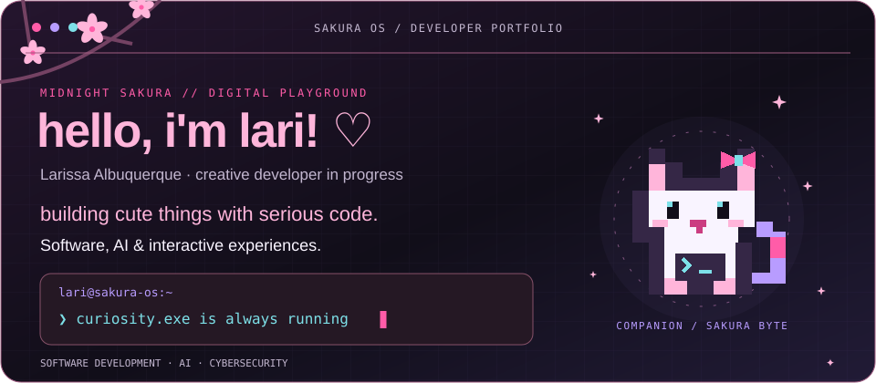
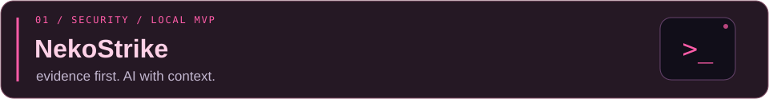
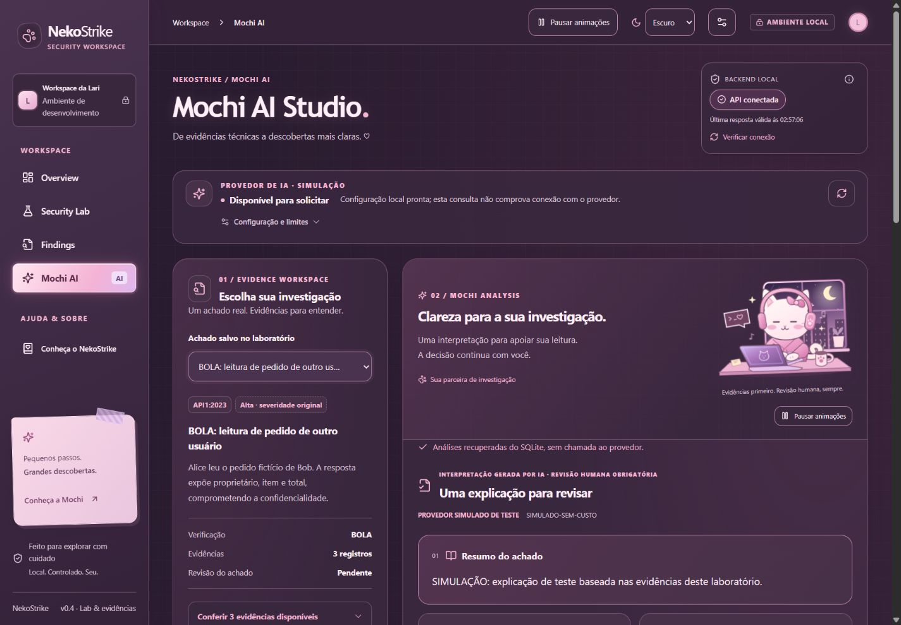
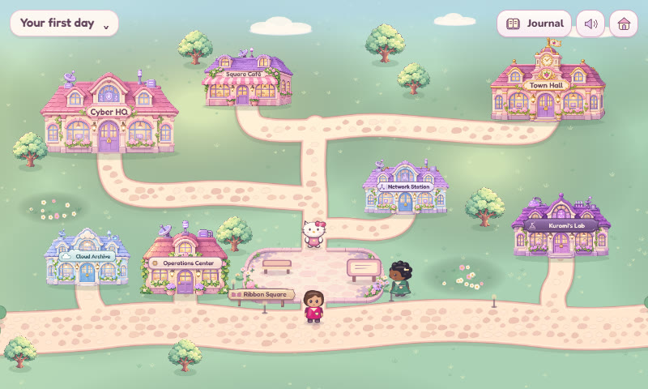
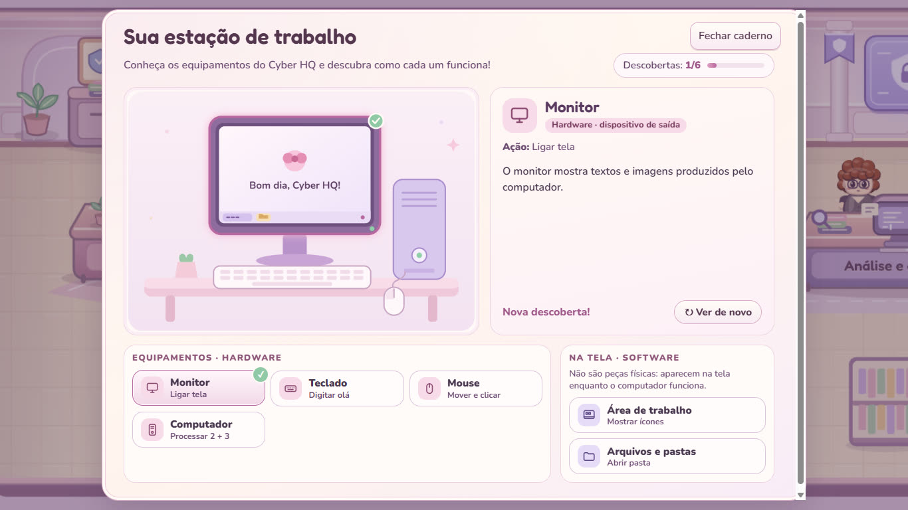
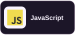
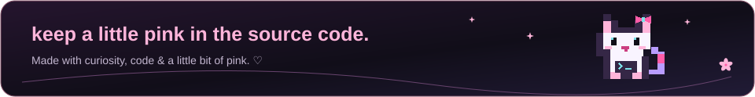

<!-- sakura:languages -->
<p align="right"><a href="README.md"></a> <a href="README.en.md"></a>
<!-- sakura:motion -->
<a href="README.en.static.md"></a>
<!-- /sakura:motion -->
</p>
<!-- /sakura:languages -->

<p align="center"><picture><source media="(max-width: 600px)" srcset="assets/profile/hero-en-mobile.svg" /></picture></p>

# Larissa Albuquerque

**Cybersecurity technology student at FIAP, Brazil · Developer in training**

I create web applications, analysis tools and educational games that connect software, AI and creativity.

I work with React, TypeScript and Python. I define each project's concept, visual direction and priorities, using AI to support implementation and review. My focus is turning ideas into working experiences, with attention to clarity, usability and the details that make a product useful.

<!-- sakura:navigation -->
<p>
<a href="#featured-projects"></a>
<a href="#technologies-and-tools"></a>
<a href="#in-development"></a>
<a href="#public-activity"></a>
<a href="#lets-connect"></a>
</p>
<!-- /sakura:navigation -->

## Featured projects

### 01 / NekoStrike

[](https://github.com/anjennlical/nekostrike)

A full-stack application bringing together controlled API security checks, evidence, history and reports. Mochi AI offers optional explanations while keeping deterministic results separate from the model's interpretation.

- **Features:** three isolated scenarios, SQLite history, Markdown export and automated tests.
- **Mochi AI:** OpenAI Responses API, structured output and validated references; disabled by default.
- **Stack:** Python, FastAPI, React, TypeScript, Vite and SQLite.

**Status:** functional local MVP undergoing refinement. No publicly hosted demo.

<!-- sakura:neko-actions -->
<p><a href="https://github.com/anjennlical/nekostrike"></a> <a href="https://github.com/anjennlical/nekostrike#architecture"></a></p>

[Validation & limitations](https://github.com/anjennlical/nekostrike/blob/main/docs/portfolio/STATUS.md)
<!-- /sakura:neko-actions -->

<details>
<summary>See Mochi AI and the engineering details</summary>



*Real screenshot from 13 November 2026, before RC26.1 spacing adjustments, using a simulated AI provider.*

The lab and reports work without an API key. Automated tests cover the backend and frontend; saved analyses can be reopened without generating another model response.

[Screenshot provenance](https://github.com/anjennlical/nekostrike/blob/main/docs/portfolio/SCREENSHOTS.md) · [AI integration & boundaries](https://github.com/anjennlical/nekostrike/blob/main/docs/portfolio/AI.md)

</details>

### 02 / Cyber Kitty Adventures

[](https://github.com/anjennlical/cyber-kitty-technical-showcase)

An educational game built with Phaser and TypeScript, introducing digital safety through exploration, storytelling and practical decisions in Byteberry Town. Activities cover files, source verification and safe information sharing.

- **Game:** learning activities and browser-saved progress, in English and Brazilian Portuguese.
- **Separate technical demo:** information classification, five save slots and checkpoints.
- **Game stack:** Phaser, TypeScript and Vite. **Technical showcase:** TypeScript, HTML, CSS and browser APIs.



*Screenshot from the full Phaser game. The public demo linked below is a separate technical experience.*

<details>
<summary>More from the game — interactive workstation</summary>



*A learning activity from the full game; this is not a screenshot of the technical demo.*

</details>

**Status:** Chapter 1 playtesting available by contacting me; public technical demo available. An independent fan project with no Sanrio affiliation; characters and artwork belong to their respective owners.

<!-- sakura:cyber-actions -->
<p><a href="https://cyber-kitty-technical-showcase.vercel.app/"></a> <a href="https://github.com/anjennlical/cyber-kitty-technical-showcase"></a> <a href="mailto:kerlalarissa@gmail.com"></a></p>

[Project provenance](https://github.com/anjennlical/cyber-kitty-technical-showcase/blob/main/docs/PROCEDENCIA.md)
<!-- /sakura:cyber-actions -->

### 03 / Nocturne AI



A project in development exploring digital investigation with AI. The proposal examines evidence analysis workflows and investigative hypotheses, with multi-agent architectures planned as part of the approach.

**Status:** in development · multi-agent architecture planned. No public repository or demo linked yet.

## Technologies and tools

### Development

<p>





</p>

I build interfaces with React, TypeScript, HTML and CSS, services with Python and FastAPI, and games with Phaser. These projects also use JavaScript, Vite and SQL/SQLite; Java is part of my additional technical knowledge.

### Artificial intelligence

<p>


</p>

ChatGPT, Claude, Codex and Gemini support prototyping and review. In NekoStrike, I integrate LLMs with structured responses and evidence validation.

### Cybersecurity

<p>


</p>

**Linux · Wireshark · Nmap · Networking · MITRE ATT&CK · SIEM/SOC · Evidence analysis**

NekoStrike demonstrates my practical work with evidence and API security. Networking, traffic analysis and monitoring practices complement my cybersecurity studies.

### Tools and infrastructure

<p>


</p>

**Git · GitHub · VS Code · PowerShell · AWS · Power BI · n8n · Make**

Git/GitHub for version control, PowerShell on Windows and n8n/Make for automation. VS Code, AWS and Power BI complete my toolkit.

<details>
<summary>Usage context and experience levels</summary>

Project technologies are documented in the repositories. My additional experience includes Java, AWS, Power BI, MITRE ATT&CK and SIEM/SOC, self-assessed between intermediate and advanced. I assess my Gemini and VS Code skills as advanced.

[Icon credits and sources](docs/ICONS.md)

</details>

## In development

<details>
<summary>What I'm refining now</summary>

```text
lari@sakura-os:~ / projects
├── NekoStrike      → local MVP refinement
├── Cyber Kitty     → Chapter 1 playtesting
└── Nocturne AI     → digital investigation with AI
```

I'm exploring how to make evidence understandable, learning experiences more interactive and analysis workflows more useful.

</details>

## Public activity

Browse my [contribution history](https://github.com/anjennlical) and [public repositories](https://github.com/anjennlical?tab=repositories) for code, documentation and the evolution of these projects.

## Let's connect

For conversations about software, AI, cybersecurity or Cyber Kitty playtesting:

<!-- sakura:contact-actions -->
<p><a href="https://www.linkedin.com/in/larissa-albuquerque-65b437241/"></a> <a href="mailto:kerlalarissa@gmail.com"></a> <a href="https://github.com/anjennlical"></a></p>

`kerlalarissa@gmail.com` · `@anjennlical`
<!-- /sakura:contact-actions -->

<p align="center"></p>

<p align="center"><a href="assets/profile/hero-en-static.svg">Static header</a> · <a href="assets/profile/footer-en-static.svg">Static footer</a></p>
