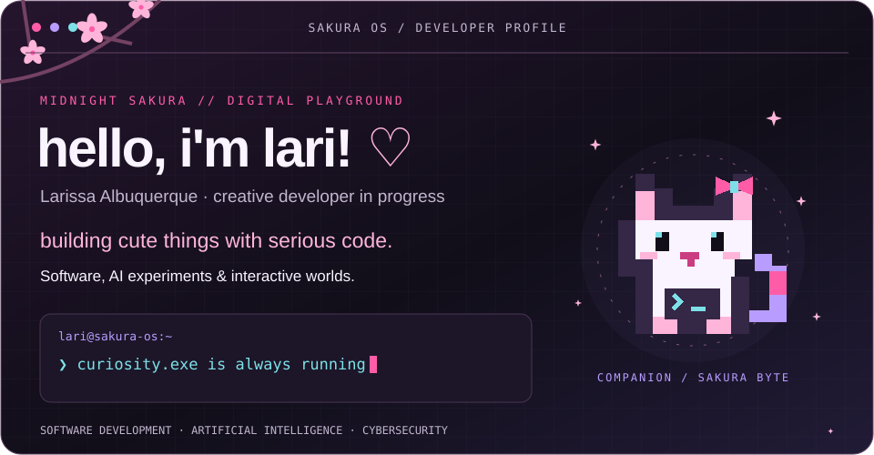
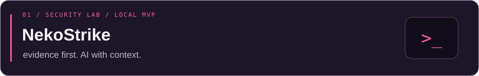
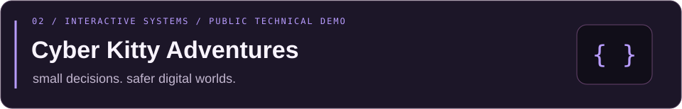
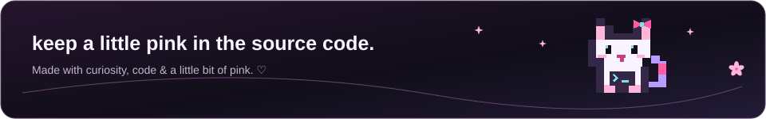

<p align="center">
  
</p>

# Larissa Albuquerque · hello, i'm lari! ♡

**Cybersecurity student at FIAP, Brazil · Software development · AI experiments · Creative coding**

I turn ideas into things you can explore: a security lab where findings keep their evidence, and interactive experiences that make digital safety easier to understand. My projects connect code, thoughtful interfaces and learning through experimentation.

*building cute things with serious code.*

[Projects](#featured-projects--things-ive-built) · [Toolkit](#my-toolkit--technologies--tools) · [In progress](#currently-building) · [Activity](#public-work--activity) · [Contact](#lets-connect)

## Featured Projects // Things I've Built

### 01 / NekoStrike

[](https://github.com/anjennlical/nekostrike)

**A local workspace for learning API security through inspectable evidence.** Run isolated vulnerable/corrected scenarios, review findings, keep execution history in SQLite and export Markdown reports.

`Python` · `FastAPI` · `React` · `TypeScript` · `Vite` · `SQLite`

**Status:** functional local MVP / portfolio release candidate. Mochi AI integrates with the OpenAI Responses API using structured outputs and evidence validation. Generation is optional, disabled by default and subject to human review. The lab and reports work without an API key.

[Explore the code](https://github.com/anjennlical/nekostrike) · [Architecture & setup](https://github.com/anjennlical/nekostrike#architecture) · [Validation & limitations](https://github.com/anjennlical/nekostrike/blob/main/docs/portfolio/STATUS.md)

<details>
<summary>Inside NekoStrike — real application capture & engineering notes</summary>


*Real screenshot from 13 November 2026, before RC26.1 spacing adjustments; simulated AI provider. This is a local application, with no public hosted demo.*

- Compares vulnerable and corrected API behavior in built-in fictional scenarios.
- Preserves HTTP evidence, finding review and saved AI analyses.
- Separates deterministic verdicts from optional AI explanations.
- Includes automated backend/frontend tests and a mock-only rehearsal.

[Screenshot provenance](https://github.com/anjennlical/nekostrike/blob/main/docs/portfolio/SCREENSHOTS.md) · [AI integration & boundaries](https://github.com/anjennlical/nekostrike/blob/main/docs/portfolio/AI.md)

</details>

### 02 / Cyber Kitty Adventures

[](https://github.com/anjennlical/cyber-kitty-technical-showcase)

**Learning digital safety by making decisions.** The public technical showcase asks players to classify fictional records: publish, verify or keep private. It demonstrates five save slots, validated versioned persistence, mission checkpoints, keyboard interaction and English / Brazilian Portuguese localization.

**Public showcase:** `TypeScript` · `HTML` · `CSS` · `Browser APIs` · `Node.js tests`

**Full game:** `Phaser` · `TypeScript` · `Vite` — a separate educational adventure combining exploration, narrative and cybersecurity challenges. Chapter 1 playtesting is available by contacting me; the public showcase focuses on the classification exercise.


*Actual capture of the full Phaser game — exploring Byteberry Town. The separate public technical demo is linked below.*

<details>
<summary>More from the game — interactive workstation</summary>


*Actual in-game learning activity. These game captures are separate from the public classification demo.*

</details>

**Status:** public technical demo available; the full game is a separate fan project with third-party characters and artwork.

[Try the demo](https://cyber-kitty-technical-showcase.vercel.app/) · [Explore the code](https://github.com/anjennlical/cyber-kitty-technical-showcase) · [Project provenance](https://github.com/anjennlical/cyber-kitty-technical-showcase/blob/main/docs/PROCEDENCIA.md) · [Ask about Chapter 1 playtesting](mailto:kerlalarissa@gmail.com)

## My Toolkit // Technologies & Tools

**In the projects above**

| Area | Practical use |
| --- | --- |
| Interfaces & interaction | TypeScript, JavaScript, React, HTML, CSS, Phaser |
| APIs & persistence | Python, FastAPI, SQL / SQLite, browser storage |
| Build & quality | Vite, Git, GitHub, pytest, Node.js test runner |
| AI integration | OpenAI SDK, Responses API, structured outputs, evidence validation |

**Studying & exploring** · Linux, networking, Wireshark, Nmap, web / API security and offensive security. These are learning interests, separate from the implemented project stack.

**AI-assisted development** · ChatGPT, Codex and Claude support my iterative workflow. I shape the concept, visual direction and priorities, and review the results. Integrating an LLM into a product is a separate part of my NekoStrike work.

## Currently Building...

```text
lari@sakura-os:~ / workspace
├── NekoStrike      → local MVP · validation & refinement
├── Cyber Kitty     → public showcase · Chapter 1 playtesting
└── curiosity.exe   → exploring AI, security & interactive design
```

I'm learning by building small systems with visible behavior: evidence you can inspect, checkpoints you can resume and interfaces you can navigate.

## Public Work // Activity

My contribution calendar lives on [my GitHub profile](https://github.com/anjennlical). Explore [my public repositories](https://github.com/anjennlical?tab=repositories) for source, documentation and project history.

<details>
<summary>Browse the technical work</summary>

- [NekoStrike — backend, frontend and test suites](https://github.com/anjennlical/nekostrike)
- [Cyber Kitty — persistence, mission state and localization](https://github.com/anjennlical/cyber-kitty-technical-showcase/tree/main/src)
- [This profile — original SVG artwork and maintenance notes](docs/PROFILE_DESIGN.md)

</details>

## Let's Connect

For software, AI and cybersecurity conversations, project feedback or Cyber Kitty playtesting:

[LinkedIn · Larissa Albuquerque](https://www.linkedin.com/in/larissa-albuquerque-65b437241/) · [Email · kerlalarissa@gmail.com](mailto:kerlalarissa@gmail.com) · [GitHub · @anjennlical](https://github.com/anjennlical)

<p align="center">
  
</p>

<p align="center"><a href="assets/profile/hero-static.svg">Static header</a> · <a href="assets/profile/footer-static.svg">Static footer</a></p>
