<p align="right"><a href="README.md">🇧🇷 Português</a> | <a href="README.en.md">🌐 English</a></p>

<p align="center"><picture><source media="(max-width: 600px)" srcset="assets/profile/hero-pt-mobile.svg" />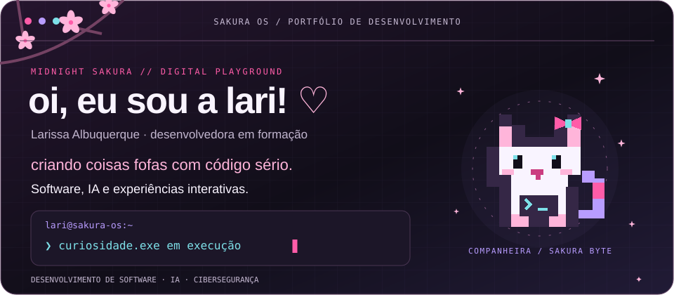</picture></p>

# Larissa Albuquerque

**Estudante de Tecnologia em Cibersegurança na FIAP · Desenvolvedora em formação**

Desenvolvo projetos que conectam software, inteligência artificial e criatividade. Gosto de transformar ideias em experiências funcionais: de aplicações web e ferramentas de análise a jogos que ajudam a aprender segurança digital.

Meu trabalho prático passa por React, TypeScript e Python, integração de modelos de linguagem e interfaces interativas. Tenho interesse em engenharia de produtos digitais e experiência do usuário: entender um problema, construir uma solução e refinar seus detalhes. Aqui compartilho meus projetos, experimentos e aprendizados ao longo desse processo.

[Projetos](#projetos-em-destaque) · [Tecnologias](#tecnologias-e-ferramentas) · [Em desenvolvimento](#em-desenvolvimento) · [Atividade](#atividade-pública) · [Contato](#vamos-conversar)

## Projetos em destaque

### 01 / NekoStrike

[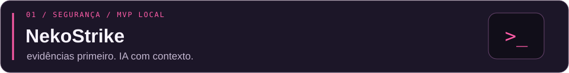](https://github.com/anjennlical/nekostrike)

Uma aplicação full-stack para estudar segurança de APIs sem perder o contexto das evidências. O NekoStrike conecta testes controlados, revisão de achados e relatórios rastreáveis em um fluxo único. A Mochi AI oferece explicações opcionais a partir dos dados coletados, mantendo os resultados determinísticos separados da interpretação do modelo e sujeitos à revisão humana.

- **Implementado:** três cenários isolados com versões vulneráveis e corrigidas, histórico em SQLite e exportação Markdown.
- **IA:** integração com a OpenAI Responses API, saída estruturada e validação de referências; geração desligada por padrão.
- **Stack:** Python, FastAPI, React, TypeScript, Vite e SQLite.

**Estado:** MVP local funcional, em refinamento. Sem demonstração pública hospedada.

[Repositório](https://github.com/anjennlical/nekostrike) · [Arquitetura](https://github.com/anjennlical/nekostrike#architecture) · [Validação e limites](https://github.com/anjennlical/nekostrike/blob/main/docs/portfolio/STATUS.md)

<details>
<summary>Ver a Mochi AI e os detalhes técnicos</summary>

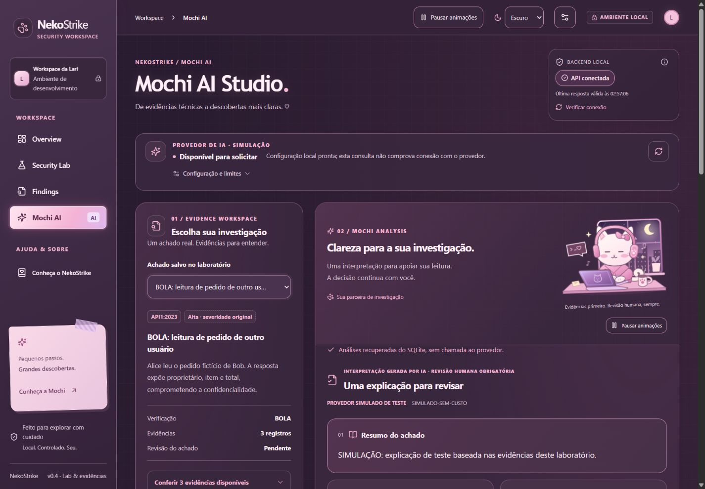

*Captura real de 13/11/2026, anterior aos ajustes de espaçamento RC26.1, com provedor de IA simulado.*

O laboratório e os relatórios funcionam sem chave de API. Testes automatizados cobrem backend e frontend; as análises salvas podem ser reabertas sem gerar uma nova resposta do modelo.

[Origem da captura](https://github.com/anjennlical/nekostrike/blob/main/docs/portfolio/SCREENSHOTS.md) · [Integração e limites da IA](https://github.com/anjennlical/nekostrike/blob/main/docs/portfolio/AI.md)

</details>

### 02 / Cyber Kitty Adventures

[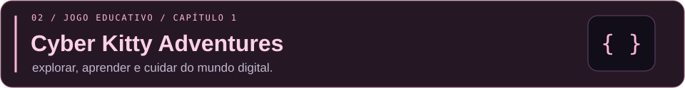](https://github.com/anjennlical/cyber-kitty-technical-showcase)

Um jogo educativo que apresenta segurança digital por meio da exploração, da narrativa e de decisões práticas em Byteberry Town. Desenvolvido com Phaser e TypeScript, transforma conceitos como organização de arquivos, verificação de origem e compartilhamento seguro em desafios interativos. A proposta é criar um espaço acolhedor para experimentar, errar e aprender antes de enfrentar situações reais.

- **No jogo:** exploração, diálogos, atividades educativas e progresso salvo no navegador, em português e inglês.
- **Na vitrine técnica pública:** classificação de informações, cinco espaços de salvamento e retomada por checkpoints.
- **Stack do jogo:** Phaser, TypeScript e Vite. **Vitrine técnica:** TypeScript, HTML, CSS e APIs do navegador.

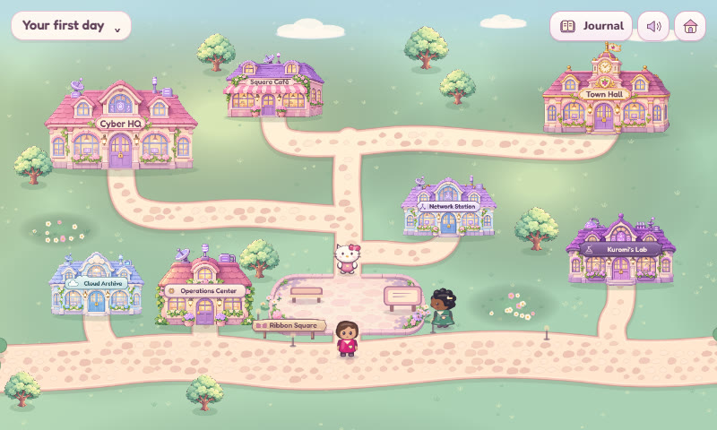

*Imagem do jogo completo em Phaser. A demonstração pública abaixo é uma experiência técnica separada.*

<details>
<summary>Mais do jogo — estação de trabalho interativa</summary>

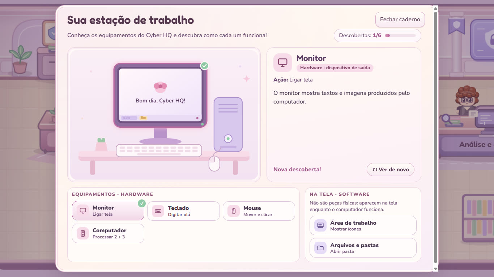

*Atividade educativa do jogo completo; não é uma captura da demonstração técnica.*

</details>

**Estado:** Capítulo 1 disponível para testes mediante contato; vitrine técnica pública disponível. Projeto de fã independente, com personagens e artes de terceiros, sem afiliação oficial com a Sanrio.

[Repositório da vitrine](https://github.com/anjennlical/cyber-kitty-technical-showcase) · [Experimentar a demo técnica](https://cyber-kitty-technical-showcase.vercel.app/) · [Conhecer o processo](https://github.com/anjennlical/cyber-kitty-technical-showcase/blob/main/docs/PROCEDENCIA.md) · [Solicitar teste do jogo](mailto:kerlalarissa@gmail.com)

### 03 / Nocturne AI

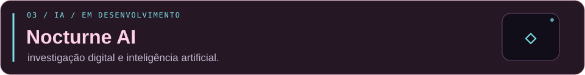

Projeto em desenvolvimento voltado à investigação digital com inteligência artificial. A proposta é explorar como arquiteturas multiagentes podem organizar etapas de análise, apoiar a compreensão de evidências e estruturar hipóteses investigativas. Combina experimentação com modelos de linguagem e desenho de fluxos de investigação, com a arquitetura multiagente como parte da direção planejada.

**Estado:** em desenvolvimento. **Direção técnica planejada:** LLMs e arquiteturas multiagentes aplicados à investigação digital. Repositório e demonstração públicos ainda não vinculados.

## Tecnologias e ferramentas

### Desenvolvimento

<p>

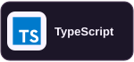
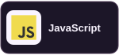

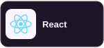


</p>

Construo interfaces com React, TypeScript, HTML e CSS, serviços com Python e FastAPI e jogos com Phaser. Uso JavaScript, Vite e SQL/SQLite nesses projetos; Java integra meus conhecimentos complementares.

### Inteligência artificial

<p>
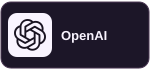


</p>

Uso ChatGPT, Claude, Codex e Gemini como apoio ao desenvolvimento, à elaboração de prompts e à análise de problemas. No NekoStrike, trabalho com integração de LLMs, respostas estruturadas e validação de evidências. Defino o conceito, a direção visual e as prioridades dos projetos, revisando os resultados.

### Cibersegurança

<p>


</p>

**Linux · Wireshark · Nmap · Redes · MITRE ATT&CK · SIEM/SOC · Análise de evidências**

O laboratório NekoStrike demonstra meu trabalho com evidências e segurança de APIs. Redes, análise de tráfego e práticas de monitoramento complementam minha formação em cibersegurança.

### Ferramentas e infraestrutura

<p>


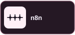

</p>

**Git · GitHub · VS Code · PowerShell · AWS · Power BI · n8n · Make**

Git e GitHub organizam o código e seu histórico; PowerShell apoia os fluxos locais no Windows. Uso n8n e Make para automação de fluxos. VS Code, AWS e Power BI fazem parte dos meus conhecimentos adicionais.

<details>
<summary>Contexto de uso e níveis de experiência</summary>

As tecnologias dos projetos estão descritas nos repositórios. Java, AWS, Power BI, MITRE ATT&CK e SIEM/SOC integram minha experiência complementar, autoavaliada entre intermediária e avançada. Minha autoavaliação de Gemini e VS Code é avançada.

[Créditos dos ícones e fontes](docs/ICONS.md)

</details>

## Em desenvolvimento

```text
lari@sakura-os:~ / projetos
├── NekoStrike      → refinamento do MVP local
├── Cyber Kitty     → testes do Capítulo 1
└── Nocturne AI     → investigação digital com IA
```

Investigo como tornar evidências compreensíveis, experiências educativas mais interativas e fluxos de análise mais úteis.

## Atividade pública

Veja o [histórico de contribuições](https://github.com/anjennlical) e os [repositórios públicos](https://github.com/anjennlical?tab=repositories) para acompanhar código, documentação e evolução dos projetos.

## Vamos conversar?

Para conversar sobre software, IA, cibersegurança ou testes do Cyber Kitty:

[LinkedIn](https://www.linkedin.com/in/larissa-albuquerque-65b437241/) · [E-mail · kerlalarissa@gmail.com](mailto:kerlalarissa@gmail.com) · [GitHub · @anjennlical](https://github.com/anjennlical)

<p align="center">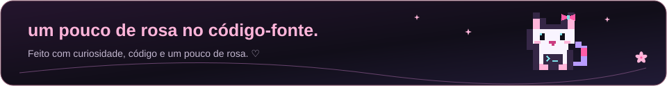</p>

<p align="center"><a href="assets/profile/hero-pt-static.svg">Cabeçalho sem animação</a> · <a href="assets/profile/footer-pt-static.svg">Rodapé sem animação</a></p>
