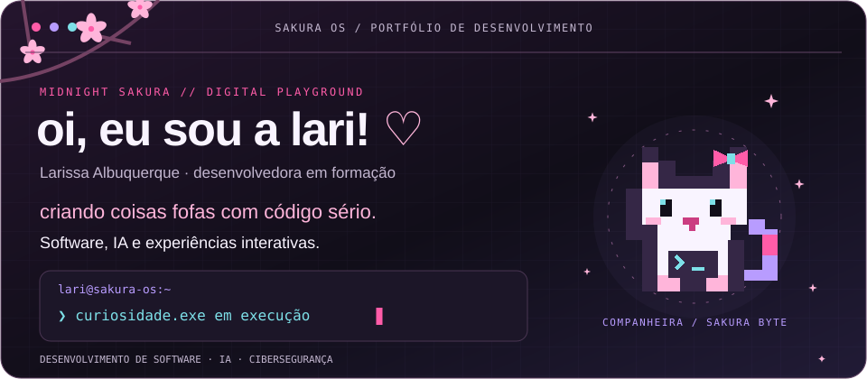
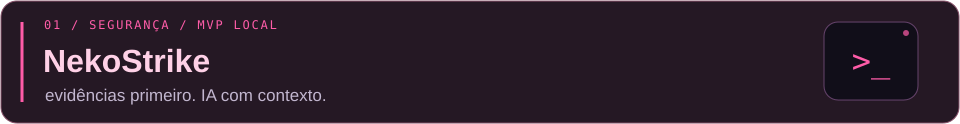
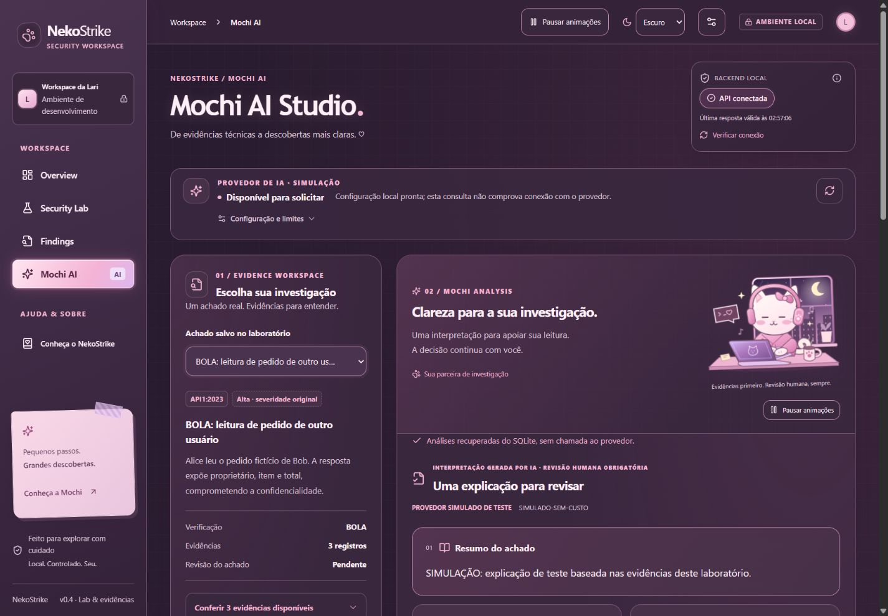
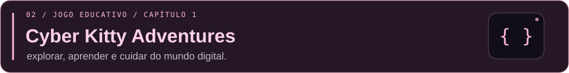
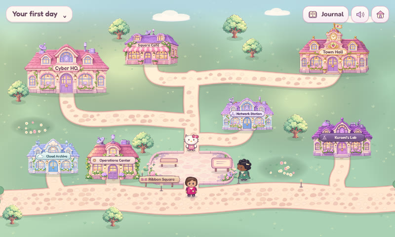
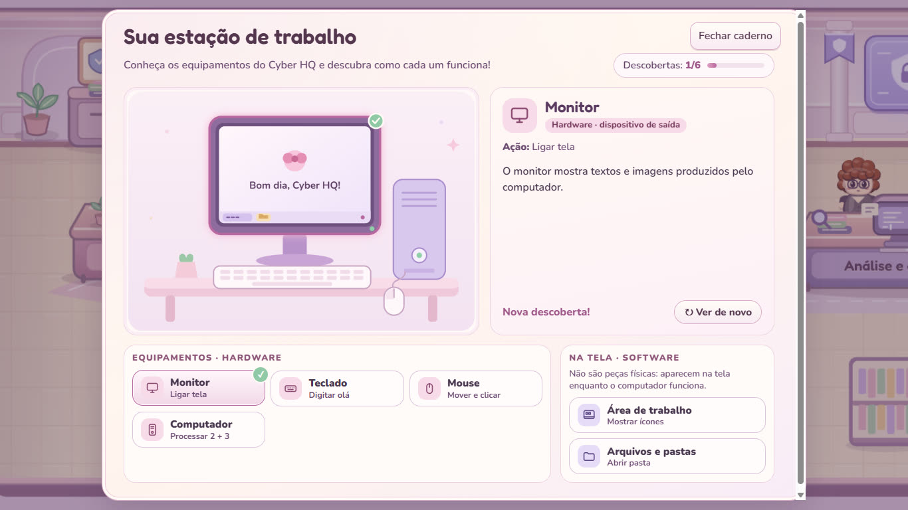
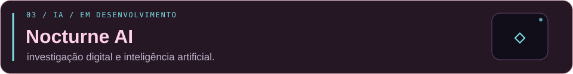
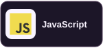
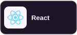
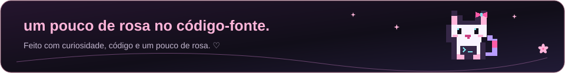

<!-- sakura:languages -->
<p align="right"><a href="README.static.md"></a> <a href="README.en.static.md"></a>
<!-- sakura:motion -->
<a href="README.md">Ver versão com animações</a>
<!-- /sakura:motion -->
</p>
<!-- /sakura:languages -->

<p align="center"><picture><source media="(max-width: 600px)" srcset="assets/profile/hero-pt-mobile-static.svg" /></picture></p>

# Larissa Albuquerque

**Estudante de Tecnologia em Cibersegurança na FIAP · Desenvolvedora em formação**

Crio aplicações web, ferramentas de análise e jogos educativos que conectam software, IA e criatividade.

Trabalho com React, TypeScript e Python. Defino o conceito, a direção visual e as prioridades dos projetos, usando IA como apoio à implementação e à revisão. Meu foco é transformar ideias em experiências funcionais, com atenção à clareza, à usabilidade e aos detalhes.

<!-- sakura:navigation -->
<p>
<a href="#projetos-em-destaque"></a>
<a href="#tecnologias-e-ferramentas"></a>
<a href="#em-desenvolvimento"></a>
<a href="#atividade-pública"></a>
<a href="#vamos-conversar"></a>
</p>
<!-- /sakura:navigation -->

## Projetos em destaque

### 01 / NekoStrike

[](https://github.com/anjennlical/nekostrike)

Uma aplicação full-stack que reúne testes controlados de segurança de APIs, evidências, histórico e relatórios. A Mochi AI oferece explicações opcionais, mantendo resultados determinísticos separados da interpretação do modelo.

- **Recursos:** três cenários isolados, histórico em SQLite, exportação Markdown e testes automatizados.
- **Mochi AI:** OpenAI Responses API, saída estruturada e referências validadas; desligada por padrão.
- **Stack:** Python, FastAPI, React, TypeScript, Vite e SQLite.

**Estado:** MVP local funcional, em refinamento. Sem demonstração pública hospedada.

<!-- sakura:neko-actions -->
<p><a href="https://github.com/anjennlical/nekostrike"></a> <a href="https://github.com/anjennlical/nekostrike#architecture"></a></p>

[Validação e limites](https://github.com/anjennlical/nekostrike/blob/main/docs/portfolio/STATUS.md)
<!-- /sakura:neko-actions -->

<details>
<summary>Ver a Mochi AI e os detalhes técnicos</summary>



*Captura real de 13/11/2026, anterior aos ajustes de espaçamento RC26.1, com provedor de IA simulado.*

O laboratório e os relatórios funcionam sem chave de API. Testes automatizados cobrem backend e frontend; as análises salvas podem ser reabertas sem gerar uma nova resposta do modelo.

[Origem da captura](https://github.com/anjennlical/nekostrike/blob/main/docs/portfolio/SCREENSHOTS.md) · [Integração e limites da IA](https://github.com/anjennlical/nekostrike/blob/main/docs/portfolio/AI.md)

</details>

### 02 / Cyber Kitty Adventures

[](https://github.com/anjennlical/cyber-kitty-technical-showcase)

Jogo educativo em Phaser e TypeScript que apresenta segurança digital por meio de exploração, narrativa e decisões práticas em Byteberry Town. As atividades abordam arquivos, verificação de origem e compartilhamento seguro.

- **Jogo:** atividades e progresso salvo no navegador, em português e inglês.
- **Demo técnica separada:** classificação de informações, cinco espaços de salvamento e checkpoints.
- **Stack do jogo:** Phaser, TypeScript e Vite. **Vitrine técnica:** TypeScript, HTML, CSS e APIs do navegador.



*Imagem do jogo completo em Phaser. A demonstração pública abaixo é uma experiência técnica separada.*

<details>
<summary>Mais do jogo — estação de trabalho interativa</summary>



*Atividade educativa do jogo completo; não é uma captura da demonstração técnica.*

</details>

**Estado:** Capítulo 1 disponível para testes mediante contato; demo técnica pública. Projeto de fã sem afiliação com a Sanrio; personagens e artes pertencem aos respectivos titulares.

<!-- sakura:cyber-actions -->
<p><a href="https://cyber-kitty-technical-showcase.vercel.app/"></a> <a href="https://github.com/anjennlical/cyber-kitty-technical-showcase"></a> <a href="mailto:kerlalarissa@gmail.com"></a></p>

[Conhecer o processo](https://github.com/anjennlical/cyber-kitty-technical-showcase/blob/main/docs/PROCEDENCIA.md)
<!-- /sakura:cyber-actions -->

### 03 / Nocturne AI



Projeto em desenvolvimento para explorar investigação digital com IA. A proposta pesquisa fluxos de análise de evidências e hipóteses investigativas, com arquiteturas multiagentes planejadas.

**Estado:** em desenvolvimento · arquitetura multiagente planejada. Ainda sem repositório ou demo públicos vinculados.

## Tecnologias e ferramentas

### Desenvolvimento

<p>







</p>

Construo interfaces com React, TypeScript, HTML e CSS, serviços com Python e FastAPI e jogos com Phaser. Uso JavaScript, Vite e SQL/SQLite nesses projetos; Java integra meus conhecimentos complementares.

### Inteligência artificial

<p>


</p>

ChatGPT, Claude, Codex e Gemini apoiam prototipação e revisão. No NekoStrike, integro LLMs com respostas estruturadas e validação de evidências.

### Cibersegurança

<p>


</p>

**Linux · Wireshark · Nmap · Redes · MITRE ATT&CK · SIEM/SOC · Análise de evidências**

O laboratório NekoStrike demonstra meu trabalho com evidências e segurança de APIs. Redes, análise de tráfego e práticas de monitoramento complementam minha formação em cibersegurança.

### Ferramentas e infraestrutura

<p>


</p>

**Git · GitHub · VS Code · PowerShell · AWS · Power BI · n8n · Make**

Git/GitHub para versionamento, PowerShell no Windows e n8n/Make para automação. VS Code, AWS e Power BI completam minhas ferramentas.

<details>
<summary>Contexto de uso e níveis de experiência</summary>

As tecnologias dos projetos estão descritas nos repositórios. Java, AWS, Power BI, MITRE ATT&CK e SIEM/SOC integram minha experiência complementar, autoavaliada entre intermediária e avançada. Minha autoavaliação de Gemini e VS Code é avançada.

[Créditos dos ícones e fontes](docs/ICONS.md)

</details>

## Em desenvolvimento

<details>
<summary>O que estou refinando agora</summary>

```text
lari@sakura-os:~ / projetos
├── NekoStrike      → refinamento do MVP local
├── Cyber Kitty     → testes do Capítulo 1
└── Nocturne AI     → investigação digital com IA
```

Investigo como tornar evidências compreensíveis, experiências educativas mais interativas e fluxos de análise mais úteis.

</details>

## Atividade pública

Veja o [histórico de contribuições](https://github.com/anjennlical) e os [repositórios públicos](https://github.com/anjennlical?tab=repositories) para acompanhar código, documentação e evolução dos projetos.

## Vamos conversar?

Para conversar sobre software, IA, cibersegurança ou testes do Cyber Kitty:

<!-- sakura:contact-actions -->
<p><a href="https://www.linkedin.com/in/larissa-albuquerque-65b437241/"></a> <a href="mailto:kerlalarissa@gmail.com"></a> <a href="https://github.com/anjennlical"></a></p>

`kerlalarissa@gmail.com` · `@anjennlical`
<!-- /sakura:contact-actions -->

<p align="center"></p>

<p align="center"><a href="assets/profile/hero-pt-static.svg">Cabeçalho sem animação</a> · <a href="assets/profile/footer-pt-static.svg">Rodapé sem animação</a></p>
